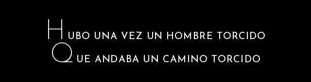
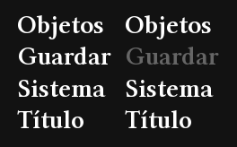
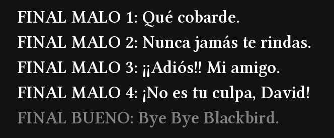

<div align="center">



# The Crooked Man — Traducción al español

**Traducción no oficial hecha por fans · Unofficial fan translation**


[**Español**](#español) · [**English**](#english)

</div>

---

<a id="español"></a>

##  Español

Esta es una **traducción completa al español** de *The Crooked Man*, el juego de terror de **Uri**, para la **versión de Steam**.

**No es una traducción oficial.** La hice yo (**anxo2077**) para que mi novia pudiera disfrutar el juego en español, y decidí compartirla gratis para que más gente de habla hispana también pueda jugarlo. No tiene relación con Uri ni con PLAYISM.

###  Qué incluye

| | |
|---|---|
| **Diálogos** | Las ~1.430 líneas de diálogo del juego, adaptadas a la voz de cada personaje (no es una traducción automática). |
| **Textos del juego** | Notas, diarios, descripciones de objetos, avisos, puzles, finales y perfiles de personajes (~810 líneas). |
| **Imágenes** | Menú de título, menú de pausa, guardado, "Fin del juego", títulos de escena, nombres de los finales y créditos. |
| **La canción** | *"There Was a Crooked Man"* adaptada al español, tanto en los diálogos como en las pantallas con imagen. |
| **Idioma propio** | Agrega **Español** como **6.º idioma**. Japonés, inglés, chino (tradicional y simplificado) y coreano siguen funcionando igual. |
| **Logros** | Los logros de Steam siguen funcionando con normalidad. |

###  Capturas

<div align="center">
<br><br>
&nbsp;&nbsp;

</div>

###  Descarga

Descarga el archivo **`Data.wolf`** desde la sección **[Releases](https://github.com/anxo2077/TheCrookedMan-espanol/releases/latest)** (también está en este repositorio: [`Data.wolf`](Data.wolf)).

> **Requisito:** tener *The Crooked Man* comprado en Steam. Este archivo **no** sirve sin el juego.

###  Instalación

1. En Steam, haz clic derecho en **The Crooked Man** → **Administrar** → **Explorar archivos locales**.
2. Haz una **copia de seguridad** de tu `Data.wolf` (por ejemplo, renómbralo a `Data_original.wolf`).
3. Copia el **`Data.wolf`** descargado en esa carpeta.
4. Abre el juego, pulsa **Shift** en la pantalla de título y elige **Español**.

Listo. Puedes cambiar de idioma en cualquier momento con **Shift** desde la pantalla de título.

###  Desinstalar / volver al original

> [!WARNING]
> **Antes** de volver a tu `Data.wolf` original (o de usar *"Verificar integridad de los archivos"* en Steam), abre el juego y **cambia el idioma a otro con Shift** (por ejemplo, *English*).

El juego guarda el idioma elegido en tu partida (y Steam lo sincroniza en la nube). Si quitas la traducción mientras Español está seleccionado, el juego original intenta cargar un idioma que no existe y muestra este error:

```
ERROR: Reading non-existant data number ... inside Type 33
```

**Cómo arreglarlo:** vuelve a poner el `Data.wolf` en español, cambia el idioma con Shift y después restaura el original.

###  Notas

- Probado con la versión actual de Steam (WOLF RPG Editor **3.695**). Si el juego recibe una actualización, puede que haga falta una nueva versión de la traducción.
- El puzle de la caja con letras del hospital sigue pidiendo la palabra **en inglés**, porque la solución está fija en el código del juego (la nota del director lo indica).
- Las fechas de notas y diarios se mantienen en el formato original, porque algunas funcionan como pistas.

###  Permisos y aviso legal

- *The Crooked Man* y todo su contenido pertenecen a **Uri**. La versión de Steam la publica **PLAYISM**.
- Las propias reglas del juego, que aparecen al iniciarlo, dicen:
  > *"No redistribution of game files **(except for translations)**."*

  Es decir, la autora **permite redistribuir los archivos del juego cuando se trata de una traducción**, que es exactamente lo que es este proyecto.
- Esta traducción es **gratuita, no oficial y sin fines de lucro**. No incluye el ejecutable del juego y necesitas tenerlo comprado para usarla.
- Si la autora o la editora piden retirarla, se retirará.

###  Problemas, sugerencias y nuevas traducciones

Únete al **Discord**: ahí puedes reportar problemas, dar sugerencias y pedir traducciones de otros juegos.

<a href="https://discord.gg/hpxvJDmPEy"></a>

Si encuentras un texto que se sale del cuadro, una errata o algo que suena raro, incluye:

- Una **captura de pantalla**.
- En qué parte del juego estabas (escena / lugar).

También puedes abrir un **[Issue](https://github.com/anxo2077/TheCrookedMan-espanol/issues)** aquí en GitHub.

###  Créditos y agradecimientos

- **Uri**: creadora de *The Crooked Man*. Gracias por hacer un juego tan especial y por permitir que la comunidad lo traduzca.
- **PLAYISM**: edición en Steam.
- **vgperson**: traducción al inglés, usada como referencia junto al japonés original.
- **Sinflower**: autor de [UberWolf](https://github.com/Sinflower/UberWolf), la herramienta usada para empaquetar los datos.
- **Acvzdo**: autor de la guía de Steam *"Traducción al español de The Crooked Man"* (2023), que fue la que mi novia usó en su momento para jugar en español. Esta traducción es nueva y no usa sus archivos, pero gracias por abrir el camino y ayudar a la comunidad.
- **Traducción al español:** anxo2077.

---

<a id="english"></a>

##  English

This is a **complete Spanish translation** of *The Crooked Man*, the horror game by **Uri**, for the **Steam version**.

**This is not an official translation.** I (**anxo2077**) made it so my girlfriend could enjoy the game in Spanish, and decided to share it for free so more Spanish-speaking players can play it too. It is not affiliated with Uri or PLAYISM.

###  What's included

| | |
|---|---|
| **Dialogue** | All ~1,430 dialogue lines, adapted to each character's voice (not machine-translated). |
| **In-game text** | Notes, diaries, item descriptions, messages, puzzles, endings and character bios (~810 lines). |
| **Images** | Title menu, pause menu, save screen, "Game Over", scene titles, ending names and credits. |
| **The rhyme** | *"There Was a Crooked Man"* adapted into Spanish, both in dialogue and in the illustrated screens. |
| **Separate language** | Adds **Español** as a **6th language**. Japanese, English, Chinese (Traditional & Simplified) and Korean keep working exactly as before. |
| **Achievements** | Steam achievements keep working normally. |

###  Download

Get **`Data.wolf`** from the **[Releases](https://github.com/anxo2077/TheCrookedMan-espanol/releases/latest)** page (also available in this repository: [`Data.wolf`](Data.wolf)).

> **Requirement:** you must own *The Crooked Man* on Steam. This file does **not** work without the game.

###  Installation

1. In Steam, right-click **The Crooked Man** → **Manage** → **Browse local files**.
2. **Back up** your `Data.wolf` (for example, rename it to `Data_original.wolf`).
3. Copy the downloaded **`Data.wolf`** into that folder.
4. Launch the game, press **Shift** on the title screen and choose **Español**.

You can switch languages at any time with **Shift** on the title screen.

###  Uninstalling / restoring the original

> [!WARNING]
> **Before** restoring your original `Data.wolf` (or using Steam's *"Verify integrity of game files"*), launch the game and **switch to another language with Shift** (e.g. *English*).

The game stores the selected language in your save data (synced by Steam Cloud). If you remove the translation while Español is selected, the original game tries to load a language that doesn't exist and shows:

```
ERROR: Reading non-existant data number ... inside Type 33
```

**Fix:** put the Spanish `Data.wolf` back, switch the language with Shift, then restore the original.

###  Notes

- Tested with the current Steam version (WOLF RPG Editor **3.695**). A future game update may require a new version of this translation.
- The hospital letter-box puzzle still expects the **English** word, since the solution is hard-coded in the game (the director's note mentions this).
- Dates in notes and diaries keep their original format, because some of them are puzzle hints.

###  Permissions & disclaimer

- *The Crooked Man* and all of its content belong to **Uri**. The Steam version is published by **PLAYISM**.
- The game's own rules, shown at startup, state:
  > *"No redistribution of game files **(except for translations)**."*

  In other words, the author **allows game files to be redistributed for translations**, which is exactly what this project is.
- This translation is **free, unofficial and non-commercial**. It does not include the game executable, and you need to own the game to use it.
- If the author or publisher asks for it to be taken down, it will be.

###  Issues, suggestions & new translations

Join the **Discord** to report problems, share suggestions or request translations of other games.

<a href="https://discord.gg/hpxvJDmPEy"></a>

If you find text overflowing a box, a typo, or something that reads oddly, please include:

- A **screenshot**.
- Where you were in the game (scene / location).

You can also open an **[Issue](https://github.com/anxo2077/TheCrookedMan-espanol/issues)** here on GitHub.

###  Credits & thanks

- **Uri**: creator of *The Crooked Man*. Thank you for such a special game, and for allowing the community to translate it.
- **PLAYISM**: Steam publisher.
- **vgperson**: English translation, used as a reference alongside the original Japanese.
- **Sinflower**: author of [UberWolf](https://github.com/Sinflower/UberWolf), used to pack the game data.
- **Acvzdo**: author of the Steam guide *"Traducción al español de The Crooked Man"* (2023), which my girlfriend originally used to play in Spanish. This translation is new and doesn't use those files, but thank you for paving the way and helping the community.
- **Spanish translation:** anxo2077.

<div align="center">
<br>
<sub>Hubo una vez un hombre torcido, que andaba un camino torcido…</sub>
</div>
